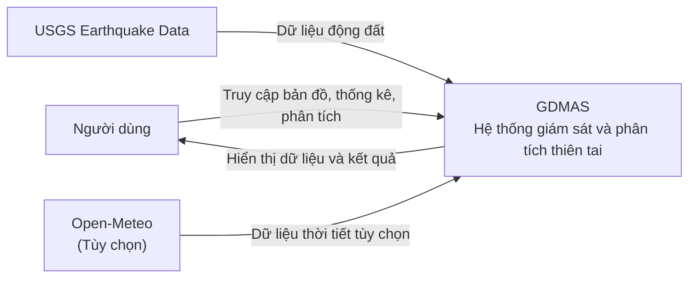
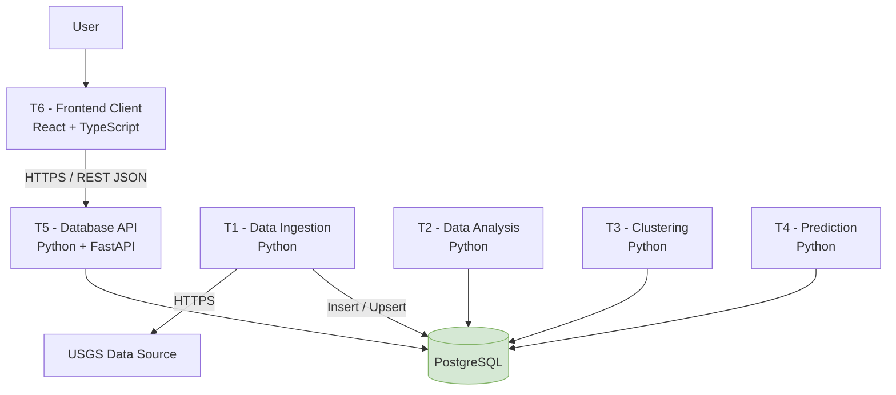
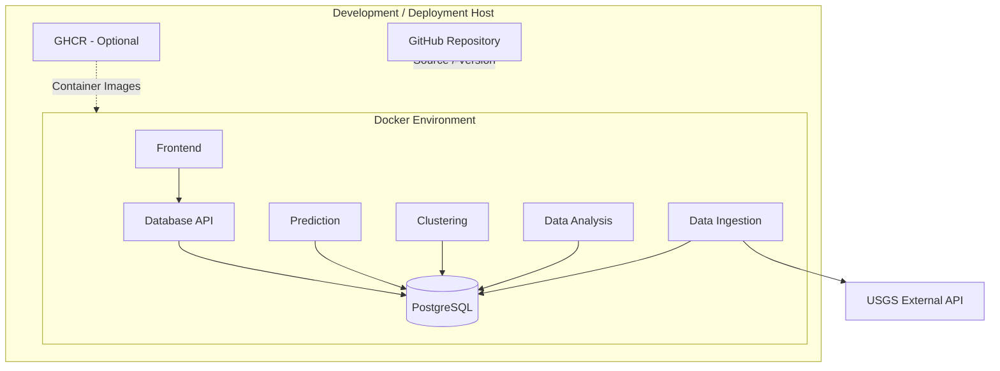
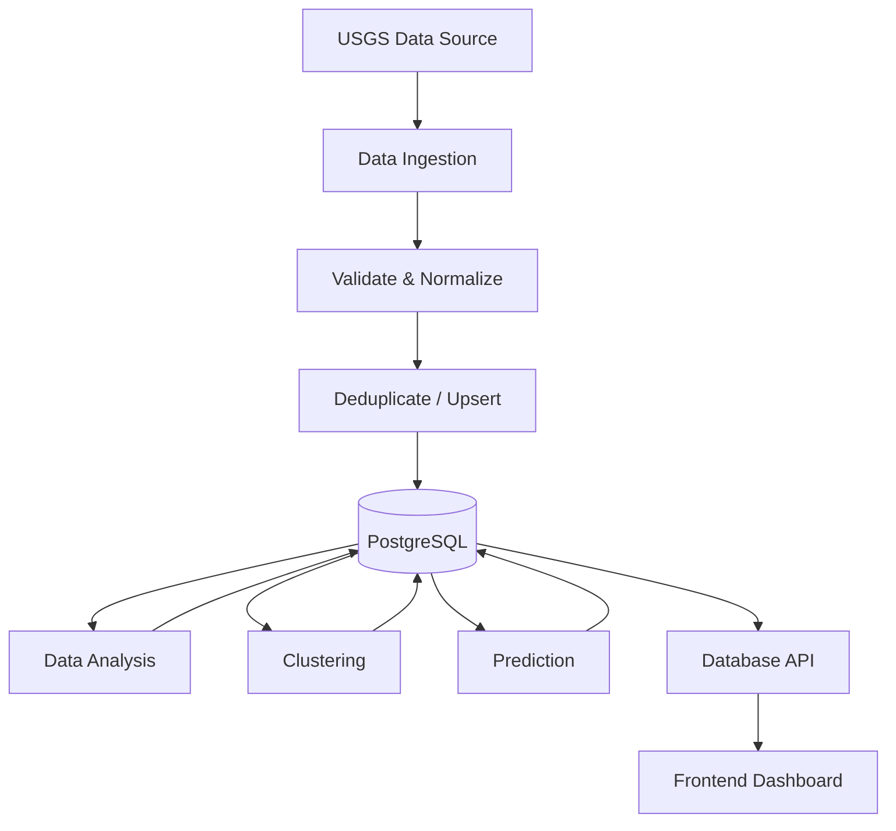
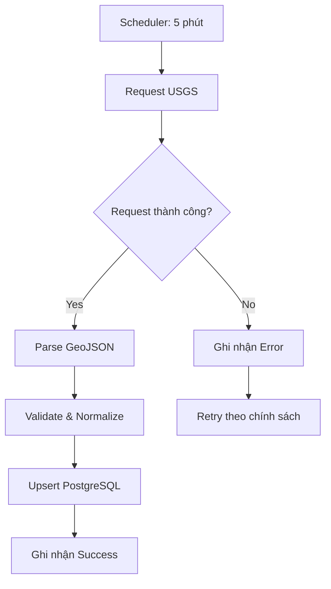

# SOFTWARE ARCHITECTURE DOCUMENT (SAD)
# TÀI LIỆU KIẾN TRÚC PHẦN MỀM

**Tên hệ thống:** Hệ thống Giám sát và Phân tích Thiên tai Toàn cầu (Global Disaster Monitoring & Analysis System)  
**Tên viết tắt:** GDMAS  
**Phiên bản:** 1.0  
**Ngày cập nhật:** 31/10/2026  
**Trạng thái:** Draft / Pending Approval  
**Phạm vi:** Đồ án học phần – 3 tuần phát triển chính và 1 tuần dự phòng.  
**Định hướng:** Nguyên mẫu phần mềm phục vụ giám sát, trực quan hóa và phân tích dữ liệu thiên tai theo chuỗi thời gian.

---

# PHẦN I. TỔNG QUAN VÀ BỐI CẢNH HỆ THỐNG

## 1. Giới thiệu

### 1.1. Mục đích tài liệu

Tài liệu Software Architecture Document (SAD) xác định kiến trúc tổng thể, công nghệ, thành phần, luồng dữ liệu, phương thức giao tiếp và các yêu cầu kỹ thuật của hệ thống GDMAS.

Tài liệu đóng vai trò:
- Cơ sở thống nhất kiến trúc giữa các thành viên phát triển.
- Định hướng triển khai Backend, Frontend, Database và các dịch vụ xử lý dữ liệu.
- Cơ sở thiết kế cơ sở dữ liệu, API và quy trình xử lý chuỗi thời gian.
- Cơ sở kiểm thử, nghiệm thu và đánh giá kỹ thuật.
- Tài liệu tham chiếu khi phát triển và bảo trì sản phẩm.

### 1.2. Mục tiêu sản phẩm

Xây dựng một ứng dụng web hỗ trợ giám sát và phân tích dữ liệu thiên tai trên phạm vi toàn cầu, tập trung vào dữ liệu động đất.

Hệ thống cung cấp ba năng lực chính:

1. **Monitoring:** Thu thập, lưu trữ và hiển thị các sự kiện động đất trên bản đồ thế giới.
2. **Analysis:** Phân tích dữ liệu chuỗi thời gian bằng các phương pháp thống kê và trực quan hóa.
3. **Prediction & Classification:** Thử nghiệm dự báo định lượng và phân loại dựa trên dữ liệu lịch sử, có đánh giá và công bố giới hạn.

### 1.3. Đối tượng sử dụng tài liệu

- Thành viên nhóm phát triển.
- Người phụ trách Backend, Frontend và xử lý dữ liệu.
- Người đánh giá kỹ thuật.
- Giảng viên hướng dẫn và hội đồng nghiệm thu.

## 2. Bối cảnh và mục tiêu hệ thống

### 2.1. Bài toán

Dữ liệu thiên tai được cung cấp từ nhiều nguồn và có thể thay đổi liên tục theo thời gian. Việc theo dõi, lưu trữ, tổng hợp và phân tích dữ liệu cần có một hệ thống thống nhất để người dùng quan sát diễn biến sự kiện và khai thác thông tin lịch sử.

Đồ án lựa chọn động đất làm loại thiên tai triển khai chính trong phiên bản đầu tiên vì:
- Có nguồn dữ liệu công khai từ USGS.
- Có dữ liệu thời gian và tọa độ địa lý.
- Có các thuộc tính định lượng như độ lớn và độ sâu.
- Phù hợp với trực quan hóa bản đồ và phân tích chuỗi thời gian.
- Có thể xây dựng nguyên mẫu với phạm vi kỹ thuật kiểm soát được.

### 2.2. Mục tiêu cụ thể

| Mã | Mục tiêu | Mức độ |
|---|---|---|
| OBJ-01 | Thu thập dữ liệu động đất từ nguồn USGS | Bắt buộc |
| OBJ-02 | Chuẩn hóa và lưu trữ dữ liệu trong PostgreSQL | Bắt buộc |
| OBJ-03 | Hiển thị sự kiện trên bản đồ toàn cầu | Bắt buộc |
| OBJ-04 | Cung cấp REST API truy xuất và lọc dữ liệu | Bắt buộc |
| OBJ-05 | Thực hiện sáu nhóm phân tích chuỗi thời gian | Bắt buộc |
| OBJ-06 | Tự động cập nhật dữ liệu theo chu kỳ | Bắt buộc |
| OBJ-07 | Thử nghiệm mô hình dự báo và phân loại | Bắt buộc theo yêu cầu phân tích, giới hạn theo tính khả thi |
| OBJ-08 | Đóng gói và quản lý mã nguồn bằng Docker, GitHub | Bắt buộc |

### 2.3. Phạm vi MVP

**Chức năng bắt buộc:**
- Bản đồ toàn cầu hiển thị các sự kiện động đất.
- Danh sách sự kiện và bộ lọc theo thời gian, độ lớn.
- Xem chi tiết sự kiện.
- Dashboard thống kê.
- REST API.
- Cơ sở dữ liệu PostgreSQL.
- Tự động thu thập dữ liệu USGS mỗi 5 phút.
- Phân tích chuỗi thời gian.
- Các biểu đồ thuộc sáu nhóm phân tích.
- Dịch vụ xử lý độc lập.
- Docker và GitHub.
- Kiểm thử các luồng xử lý chính.

**Chức năng mở rộng nếu còn thời gian:**
- PostGIS và truy vấn không gian nâng cao.
- Phân cụm sự kiện theo khu vực.
- Mô hình Machine Learning thử nghiệm.
- Dữ liệu thời tiết từ Open-Meteo.
- Docker image tự động xây dựng và lưu trữ trên GHCR.

**Ngoài phạm vi MVP:**
- Dự báo chính xác thời điểm và vị trí xảy ra động đất.
- Dự báo sóng thần hoặc phát cảnh báo thiên tai chính thức.
- Hệ thống cảnh báo khẩn cấp cho cộng đồng.
- Hạ tầng triển khai đa vùng trên toàn thế giới.
- Kafka, Kubernetes và hệ thống microservices phân tán quy mô lớn.
- MLOps, huấn luyện mô hình liên tục và quản lý nhiều phiên bản mô hình phức tạp.
- Tích hợp thanh toán, tài khoản người dùng và thông báo đa kênh.

### 2.4. Phạm vi dữ liệu

| Nhóm dữ liệu | Nội dung | Nguồn |
|---|---|---|
| Earthquake Events | Thời gian, tọa độ, độ lớn, độ sâu, địa điểm | USGS |
| Historical Events | Sự kiện động đất lịch sử | USGS |
| Analysis Results | Kết quả phân tích chuỗi thời gian | Nội bộ |
| Clustering Results | Nhóm sự kiện và thông tin cụm | Nội bộ |
| Prediction Results | Giá trị dự báo định lượng | Nội bộ |
| Classification Results | Nhãn phân loại hoạt động địa chấn | Nội bộ |
| Weather Data | Thời tiết, nếu tích hợp | Open-Meteo |

## 3. Tổng quan kiến trúc

### 3.1. Mô hình kiến trúc

Hệ thống áp dụng kiến trúc **Modular Services – các dịch vụ độc lập theo chức năng**, kết hợp mô hình xử lý dữ liệu tập trung.

Đặc điểm:
- Các dịch vụ xử lý dữ liệu được tách thành tiến trình riêng.
- Mỗi dịch vụ có trách nhiệm và cấu hình riêng.
- Các dịch vụ sử dụng chung PostgreSQL làm nơi lưu trữ dữ liệu.
- Frontend chỉ giao tiếp với Backend thông qua Database API.
- Các dịch vụ xử lý dữ liệu không giao tiếp trực tiếp với Frontend.
- Các tác vụ định kỳ hoạt động độc lập với vòng đời API.

Đây là kiến trúc dịch vụ độc lập ở mức triển khai, không yêu cầu xây dựng một hệ thống microservices phân tán đầy đủ.

### 3.2. Sơ đồ C4 – Level 1: System Context



### 3.3. Sơ đồ C4 – Level 2: Container



### 3.4. Mô hình giao tiếp

| Thành phần | Giao tiếp | Mục đích |
|---|---|---|
| Frontend → API | HTTP REST/JSON | Truy xuất dữ liệu |
| API → PostgreSQL | SQL/ORM | Truy vấn dữ liệu |
| Ingestion → USGS | HTTPS/GeoJSON | Thu thập dữ liệu |
| Ingestion → PostgreSQL | SQL/ORM | Lưu và cập nhật dữ liệu |
| Analysis → PostgreSQL | SQL/ORM | Đọc dữ liệu và lưu kết quả |
| Clustering → PostgreSQL | SQL/ORM | Đọc dữ liệu và lưu kết quả phân cụm |
| Prediction → PostgreSQL | SQL/ORM | Đọc dữ liệu và lưu kết quả dự báo |
| Các service → Logging | Application Logs | Theo dõi hoạt động |

Các dịch vụ dùng chung cơ sở dữ liệu, không yêu cầu triển khai Message Broker trong MVP.

## 4. Công nghệ sử dụng (Technology Stack)

### 4.1. Công nghệ bắt buộc

| Thành phần | Công nghệ | Vai trò |
|---|---|---|
| Backend | Python | Ngôn ngữ phát triển Backend |
| Database | PostgreSQL | Lưu trữ dữ liệu hệ thống |
| Source Control | Git + GitHub | Quản lý mã nguồn và phiên bản |
| Containerization | Docker | Đóng gói ứng dụng và môi trường |
| Orchestration | Docker Compose | Khởi chạy các service |

### 4.2. Công nghệ đề xuất

| Thành phần | Công nghệ | Vai trò |
|---|---|---|
| Backend Framework | FastAPI | Xây dựng REST API |
| ORM | SQLAlchemy | Truy cập cơ sở dữ liệu |
| Database Driver | Psycopg | Kết nối PostgreSQL |
| Migration | Alembic | Quản lý thay đổi cấu trúc DB |
| Frontend | React + TypeScript | Giao diện người dùng |
| Build Tool | Vite | Khởi tạo và đóng gói Frontend |
| Map | MapLibre GL JS | Hiển thị bản đồ |
| Charts | Recharts hoặc ECharts | Biểu đồ phân tích |
| Data Processing | Pandas, NumPy | Tiền xử lý dữ liệu |
| Statistics | Statsmodels, SciPy | Phân tích thống kê |
| Machine Learning | Scikit-learn | Phân cụm, hồi quy, phân loại |
| Scheduling | APScheduler | Quản lý tác vụ định kỳ |
| Testing | Pytest | Kiểm thử Python |
| API Testing | Postman | Kiểm thử REST API |
| Container Registry | GHCR | Lưu trữ Docker image, nếu triển khai |

**Nguyên tắc lựa chọn:** Ưu tiên thư viện phổ biến, tài liệu đầy đủ, tương thích Python và có thể triển khai trong thời gian đồ án.

---

# PHẦN II. KIẾN TRÚC VÀ THÀNH PHẦN PHẦN MỀM

## 5. Kiến trúc hạ tầng và triển khai (Infrastructure & Deployment)

### 5.1. Mô hình triển khai

Hệ thống được triển khai theo mô hình các service độc lập, chạy bằng Docker Container.

Các service được định nghĩa trong Docker Compose và có thể quản lý riêng biệt.



### 5.2. Các service triển khai

| Mã | Service | Tiến trình | Trạng thái |
|---|---|---|---|
| T1 | Data Ingestion | Python Worker | Bắt buộc |
| T2 | Data Analysis | Python Worker | Bắt buộc |
| T3 | Clustering | Python Worker | Bắt buộc |
| T4 | Prediction | Python Worker | Bắt buộc |
| T5 | Database API | FastAPI Server | Bắt buộc |
| T6 | Frontend Client | React/Vite | Bắt buộc |
| DB | PostgreSQL | Database Server | Bắt buộc |

Mỗi service phải:
- Có entrypoint riêng.
- Có cấu hình môi trường riêng khi cần.
- Có log hoạt động riêng.
- Có thể khởi động và dừng độc lập.
- Không phụ thuộc vào việc người dùng mở giao diện.
- Có khả năng kết nối đến PostgreSQL thông qua cấu hình chung.

**Quy định vận hành:** Khi phát triển trực tiếp, mỗi service được chạy trong một terminal riêng. Khi chạy bằng Docker, mỗi service tương ứng với một container hoặc một tiến trình độc lập, có thể xem log và quản lý riêng bằng Docker Compose.

### 5.3. Môi trường triển khai

**Development:**
- Python virtual environment.
- Node.js và npm cho Frontend.
- PostgreSQL cục bộ hoặc Docker.
- Git/GitHub.
- Docker Desktop hoặc Docker Engine.

**Deployment:**
- Docker Container.
- Docker Compose.
- PostgreSQL volume.
- Environment Variables.
- GitHub Repository.
- GHCR nếu cần phân phối image.

### 5.4. Nguyên tắc triển khai

- Không hardcode thông tin kết nối cơ sở dữ liệu.
- Không lưu dữ liệu quan trọng bên trong filesystem tạm của container.
- PostgreSQL sử dụng Docker named volume.
- Các service sử dụng Docker network nội bộ.
- Chỉ công khai các cổng cần thiết.
- Không để Frontend truy cập trực tiếp PostgreSQL.
- Có thể restart từng service mà không cần khởi động lại toàn bộ hệ thống.

## 6. Thành phần hệ thống (Container / Component / Client)

### 6.1. T1 – Data Ingestion

**Trách nhiệm:** Thu thập dữ liệu từ các nguồn bên ngoài và đưa vào hệ thống.

Chức năng:
- Gửi yêu cầu lấy dữ liệu USGS.
- Nhận dữ liệu GeoJSON.
- Kiểm tra cấu trúc dữ liệu.
- Chuẩn hóa trường dữ liệu.
- Kiểm tra dữ liệu thiếu hoặc không hợp lệ.
- Loại bỏ bản ghi trùng thông qua cơ chế Upsert.
- Lưu dữ liệu vào PostgreSQL.
- Ghi nhận thời điểm thu thập và trạng thái tác vụ.

Chu kỳ: 5 phút/lần.

### 6.2. T2 – Data Analysis

**Trách nhiệm:** Phân tích dữ liệu chuỗi thời gian và tạo kết quả thống kê.

Chức năng:
- Truy xuất dữ liệu từ PostgreSQL.
- Tổng hợp dữ liệu theo ngày, tuần và tháng.
- Resampling dữ liệu.
- Phân tích xu hướng.
- Phân tích tính mùa vụ.
- Phân tích tương quan.
- Tạo dữ liệu biểu đồ.
- Lưu kết quả phân tích.

Chu kỳ: 5 phút/lần.

### 6.3. T3 – Clustering

**Trách nhiệm:** Phân nhóm các sự kiện dựa trên đặc trưng dữ liệu.

Chức năng:
- Truy xuất dữ liệu lịch sử.
- Chuẩn hóa dữ liệu đầu vào.
- Lựa chọn đặc trưng.
- Thực hiện thuật toán phân cụm.
- Ghi nhận nhãn cụm và kết quả.
- Cung cấp dữ liệu phân cụm cho API.

Định hướng thuật toán:
- K-Means.
- DBSCAN.

Ưu tiên DBSCAN khi cần phân tích các nhóm sự kiện theo vị trí địa lý và mật độ. K-Means được dùng làm phương án thử nghiệm khi dữ liệu đã được chuẩn hóa và xác định số cụm phù hợp.

Chu kỳ: 1 ngày/lần.

### 6.4. T4 – Prediction

**Trách nhiệm:** Thực hiện dự báo định lượng và phân loại trên dữ liệu lịch sử.

Chức năng:
- Truy xuất chuỗi dữ liệu đã tổng hợp.
- Kiểm tra dữ liệu đầu vào.
- Thực hiện dự báo.
- Thực hiện phân loại.
- Đánh giá kết quả bằng dữ liệu kiểm thử theo thời gian.
- Lưu kết quả dự báo và nhãn phân loại.
- Ghi nhận phiên bản phương pháp hoặc mô hình.

Định hướng:
- Dự báo số lượng sự kiện trong ngày tiếp theo.
- Phân loại mức hoạt động địa chấn theo ngưỡng được định nghĩa từ dữ liệu lịch sử.
- So sánh với baseline đơn giản.

Chu kỳ: 5 phút/lần hoặc sau khi có dữ liệu mới, theo cấu hình triển khai.

**Giới hạn:** Kết quả là dự báo thống kê thử nghiệm về hoạt động địa chấn tổng hợp, không phải dự báo chính xác sự kiện động đất riêng lẻ.

### 6.5. T5 – Database API

**Trách nhiệm:** Cung cấp REST API cho Frontend và các chức năng truy xuất dữ liệu.

Công nghệ: Python + FastAPI.

Chức năng:
- Cung cấp API danh sách sự kiện.
- Cung cấp API chi tiết sự kiện.
- Hỗ trợ lọc dữ liệu.
- Cung cấp thống kê.
- Cung cấp dữ liệu biểu đồ.
- Cung cấp kết quả phân cụm.
- Cung cấp kết quả dự báo và phân loại.
- Kiểm tra tham số đầu vào.
- Chuẩn hóa cấu trúc phản hồi.
- Ghi nhận lỗi truy vấn.

### 6.6. T6 – Frontend Client

**Trách nhiệm:** Cung cấp giao diện tương tác và trực quan hóa dữ liệu.

Công nghệ:
- React.
- TypeScript.
- MapLibre GL JS.
- Recharts hoặc ECharts.

Chức năng:
- Dashboard tổng quan.
- Bản đồ động đất toàn cầu.
- Danh sách sự kiện.
- Bộ lọc dữ liệu.
- Chi tiết sự kiện.
- Sáu nhóm biểu đồ phân tích.
- Hiển thị kết quả dự báo.
- Hiển thị kết quả phân loại.
- Hiển thị thời điểm cập nhật gần nhất.
- Hiển thị trạng thái dữ liệu và lỗi.

### 6.7. Database – PostgreSQL

**Trách nhiệm:** Lưu trữ dữ liệu tập trung của hệ thống.

Các nhóm dữ liệu:
- Sự kiện động đất.
- Dữ liệu chuỗi thời gian tổng hợp.
- Kết quả phân tích.
- Kết quả phân cụm.
- Kết quả dự báo.
- Kết quả phân loại.
- Trạng thái các tác vụ.
- Nhật ký hoạt động cần thiết.

Định hướng mở rộng:
- Sử dụng PostGIS để truy vấn dữ liệu không gian.
- Sử dụng JSONB để lưu dữ liệu gốc có cấu trúc linh hoạt khi cần.

## 7. Giao tiếp và tích hợp API

### 7.1. Nguyên tắc API

- Sử dụng RESTful API.
- Dữ liệu trao đổi theo JSON.
- Sử dụng HTTP Status Code phù hợp.
- Có cấu trúc phản hồi thống nhất.
- Có phân trang đối với danh sách lớn.
- Có kiểm tra tham số đầu vào.
- Không để lộ thông tin kết nối hoặc lỗi nội bộ.

### 7.2. Danh sách API đề xuất

| Method | Endpoint | Chức năng |
|---|---|---|
| GET | `/api/health` | Kiểm tra trạng thái API |
| GET | `/api/earthquakes` | Danh sách sự kiện |
| GET | `/api/earthquakes/{id}` | Chi tiết sự kiện |
| GET | `/api/statistics/earthquakes` | Thống kê tổng hợp |
| GET | `/api/analysis/temporal` | Trực quan hóa theo thời gian |
| GET | `/api/analysis/trend` | Kết quả Trend Analysis |
| GET | `/api/analysis/seasonality` | Kết quả Seasonality |
| GET | `/api/analysis/correlation` | Ma trận tương quan |
| GET | `/api/predictions` | Kết quả dự báo |
| GET | `/api/classifications` | Kết quả phân loại |
| GET | `/api/clusters` | Kết quả phân cụm |
| GET | `/api/system/status` | Trạng thái các service và cập nhật dữ liệu |

Các endpoint là đặc tả ở mức kiến trúc, chưa phải hợp đồng API cuối cùng.

### 7.3. Quy ước dữ liệu

- Thời gian sử dụng ISO 8601 và lưu trữ thống nhất theo UTC.
- Tọa độ địa lý theo WGS84.
- Độ sâu sử dụng km.
- Độ lớn sử dụng giá trị magnitude và ghi nhận loại magnitude nếu nguồn cung cấp.
- Dữ liệu dự báo phải phân biệt với dữ liệu quan sát.
- Kết quả phân tích phải có khoảng thời gian và thời điểm tạo.

### 7.4. Cấu trúc phản hồi

Ví dụ:

```json
{
  "success": true,
  "data": [],
  "metadata": {
    "total": 0,
    "page": 1,
    "limit": 20,
    "last_updated": "2026-10-31T07:00:00Z"
  }
}
```

Cấu trúc lỗi:

```json
{
  "success": false,
  "error": {
    "code": "DATA_SOURCE_UNAVAILABLE",
    "message": "Unable to retrieve external data"
  }
}
```

### 7.5. Giao tiếp giữa các service

Trong MVP, các service giao tiếp thông qua PostgreSQL.

Không yêu cầu:
- REST API nội bộ giữa tất cả các service.
- Message Broker.
- Hệ thống RPC.
- Event Streaming.

Các service cần sử dụng quy ước chung về bảng dữ liệu, trạng thái xử lý và thời gian cập nhật.

## 8. Kiến trúc dữ liệu (Data Architecture)

### 8.1. Nguồn dữ liệu chính

**USGS Earthquake Catalog / GeoJSON Feeds**

Dữ liệu cung cấp:
- Mã sự kiện.
- Thời gian xảy ra.
- Thời gian cập nhật.
- Vị trí.
- Độ lớn.
- Độ sâu.
- Địa điểm mô tả.
- Đường dẫn thông tin sự kiện.

Nguồn chính thức: USGS Earthquake Hazards Program.

Hệ thống ưu tiên GeoJSON Feed cho cập nhật sự kiện gần đây và sử dụng FDSN Event API khi cần truy vấn dữ liệu lịch sử hoặc theo điều kiện cụ thể.

### 8.2. Quy trình dữ liệu



### 8.3. Thiết kế dữ liệu chính

#### Bảng `earthquake_events`

| Trường | Kiểu dữ liệu | Mô tả |
|---|---|---|
| id | BIGSERIAL | Khóa chính |
| source | VARCHAR | Nguồn dữ liệu |
| source_event_id | VARCHAR | Mã sự kiện nguồn |
| event_time | TIMESTAMPTZ | Thời điểm xảy ra |
| source_updated_at | TIMESTAMPTZ | Thời điểm nguồn cập nhật |
| ingested_at | TIMESTAMPTZ | Thời điểm thu thập |
| latitude | DOUBLE PRECISION | Vĩ độ |
| longitude | DOUBLE PRECISION | Kinh độ |
| depth_km | DOUBLE PRECISION | Độ sâu |
| magnitude | DOUBLE PRECISION | Độ lớn |
| magnitude_type | VARCHAR | Loại magnitude |
| place | TEXT | Mô tả địa điểm |
| source_url | TEXT | URL nguồn |
| raw_data | JSONB | Dữ liệu gốc tùy nhu cầu |

Ràng buộc:
- Khóa chính nội bộ.
- UNIQUE `(source, source_event_id)`.
- Kiểm tra tọa độ trong phạm vi hợp lệ.
- Chỉ mục cho thời gian và các trường thường xuyên lọc.

#### Các bảng dữ liệu kết quả

| Bảng | Nội dung |
|---|---|
| `analysis_results` | Kết quả phân tích chuỗi thời gian |
| `clustering_results` | Kết quả phân cụm |
| `prediction_results` | Kết quả dự báo |
| `classification_results` | Kết quả phân loại |
| `service_runs` | Trạng thái và lịch sử tác vụ |

Các bảng kết quả cần lưu thời điểm xử lý, khoảng thời gian dữ liệu, phương pháp sử dụng và thông tin phiên bản khi phù hợp.

### 8.4. Nguyên tắc lưu trữ

- PostgreSQL là nguồn dữ liệu chính thức của hệ thống.
- Không lưu dữ liệu quan trọng chỉ trong RAM.
- Không ghi đè dữ liệu lịch sử khi không có lý do nghiệp vụ.
- Dùng Upsert để xử lý bản ghi nguồn được cập nhật.
- Tách dữ liệu quan sát và kết quả dự báo.
- Lưu thời gian thu thập riêng với thời gian sự kiện.
- Chỉ giữ dữ liệu thô khi có giá trị phục vụ đối chiếu hoặc phân tích.

### 8.5. Dữ liệu không gian

PostGIS được đề xuất để hỗ trợ:
- Truy vấn sự kiện trong khu vực địa lý.
- Truy vấn theo bán kính.
- Tính toán khoảng cách.
- Hiển thị và phân tích dữ liệu không gian.

Nếu thời gian hạn chế, hệ thống có thể bắt đầu với latitude và longitude trong PostgreSQL, sau đó bổ sung PostGIS mà không thay đổi mô hình nghiệp vụ chính.

## 9. Kiến trúc sự kiện và xử lý định kỳ (Events & Scheduling)

### 9.1. Chu kỳ thực thi

| Service | Chu kỳ | Nhiệm vụ |
|---|---|---|
| Data Ingestion | 5 phút | Thu thập dữ liệu |
| Data Analysis | 5 phút | Phân tích và cập nhật kết quả |
| Clustering | 1 ngày | Phân cụm dữ liệu lịch sử |
| Prediction | 5 phút | Cập nhật kết quả dự báo |
| Database API | Liên tục | Phục vụ truy vấn |
| Frontend | Theo truy cập | Hiển thị dữ liệu |

### 9.2. Cơ chế lập lịch

Sử dụng APScheduler hoặc cơ chế scheduler tương đương trong từng service.

Nguyên tắc:
- Mỗi worker có scheduler riêng.
- Không chạy đồng thời hai tác vụ trùng phạm vi dữ liệu nếu chưa có cơ chế kiểm soát.
- Ghi nhận thời điểm bắt đầu và kết thúc.
- Có timeout.
- Có retry giới hạn.
- Ghi nhận trạng thái thành công hoặc thất bại.
- Có khả năng chạy lại tác vụ khi xảy ra lỗi.

### 9.3. Thứ tự xử lý

1. Data Ingestion thu thập dữ liệu.
2. Kiểm tra và cập nhật PostgreSQL.
3. Data Analysis đọc dữ liệu mới và cập nhật thống kê.
4. Prediction đọc chuỗi dữ liệu tổng hợp và cập nhật dự báo.
5. Clustering thực hiện theo lịch hằng ngày.
6. API cung cấp kết quả mới nhất cho Frontend.

### 9.4. Kiểm soát dữ liệu cũ

Nếu nguồn dữ liệu không truy cập được:
- Không xóa dữ liệu đã lưu.
- Không giả định dữ liệu vẫn được cập nhật.
- Ghi nhận lần thu thập thành công gần nhất.
- API trả về thời điểm cập nhật gần nhất.
- Frontend hiển thị trạng thái dữ liệu cũ hoặc gián đoạn.

---

# PHẦN III. LUỒNG XỬ LÝ VÀ NGHIỆP VỤ

## 10. Luồng nghiệp vụ chính (Business Flows)

### 10.1. Luồng thu thập dữ liệu



### 10.2. Luồng phân tích dữ liệu

1. Data Analysis được kích hoạt.
2. Truy vấn dữ liệu lịch sử.
3. Kiểm tra dữ liệu thiếu.
4. Chuẩn hóa và resampling.
5. Thực hiện các phương pháp phân tích.
6. Lưu kết quả.
7. API cung cấp dữ liệu cho Frontend.

### 10.3. Luồng phân cụm

1. Scheduler kích hoạt hằng ngày.
2. Lấy dữ liệu lịch sử.
3. Chọn các đặc trưng cần thiết.
4. Chuẩn hóa dữ liệu.
5. Thực hiện phân cụm.
6. Đánh giá và lưu kết quả.
7. Frontend hiển thị nhóm sự kiện.

### 10.4. Luồng dự báo và phân loại

1. Prediction đọc dữ liệu chuỗi thời gian.
2. Xác định khoảng thời gian huấn luyện và đánh giá.
3. Thực hiện dự báo hoặc phân loại.
4. Đánh giá kết quả.
5. Lưu kết quả.
6. API cung cấp dữ liệu dự báo cho Frontend.
7. Frontend phân biệt rõ dữ liệu thực tế và dữ liệu dự báo.

## 11. Luồng dữ liệu (Data Flows)

### 11.1. Luồng tổng thể

`USGS → Data Ingestion → PostgreSQL → Analysis / Clustering / Prediction → PostgreSQL → Database API → Frontend`

### 11.2. Các giai đoạn biến đổi

| Giai đoạn | Đầu vào | Xử lý | Đầu ra |
|---|---|---|---|
| Ingestion | GeoJSON | Kiểm tra và chuẩn hóa | Dữ liệu sự kiện |
| Storage | Dữ liệu chuẩn hóa | Upsert | Bản ghi lưu trữ |
| Analysis | Dữ liệu lịch sử | Resampling, thống kê | Kết quả phân tích |
| Clustering | Đặc trưng dữ liệu | Phân nhóm | Nhãn cụm |
| Prediction | Chuỗi dữ liệu | Hồi quy và dự báo | Giá trị dự báo |
| Classification | Đặc trưng dữ liệu | Phân loại | Nhãn dự đoán |
| API | Dữ liệu đã lưu | Truy vấn và định dạng | JSON |
| Frontend | JSON | Trực quan hóa | Bản đồ và biểu đồ |

## 12. Các phương pháp phân tích dữ liệu

Hệ thống phải hỗ trợ đầy đủ sáu nhóm phân tích bắt buộc.

### P-01. Temporal Visualization – Biểu diễn theo thời gian

**Mục tiêu:** Quan sát diễn biến dữ liệu động đất theo các khoảng thời gian khác nhau.

Biểu đồ bắt buộc:

| Biểu đồ | Nội dung |
|---|---|
| Line Chart | Xu hướng số lượng sự kiện hoặc magnitude tổng hợp theo thời gian |
| Scatter Plot | Phân bố các sự kiện theo thời điểm và giá trị đo |
| Histogram | Phân phối tần suất magnitude hoặc độ sâu |

Phạm vi:
- Ngày.
- Tuần.
- Tháng.

### P-02. Trend Analysis – Phân tích xu hướng

**Mục tiêu:** Xác định xu hướng thay đổi của dữ liệu theo thời gian.

Phương pháp:
- Resampling.
- Moving Average.
- Trend Decomposition.

Phạm vi:
- Tháng.
- Tuần nếu dữ liệu chưa đủ.

Đầu ra:
- Chuỗi dữ liệu đã tổng hợp.
- Đường xu hướng.
- Nhận xét định lượng.

### P-03. Seasonality Analysis – Phân tích tính mùa vụ

**Mục tiêu:** Khảo sát sự lặp lại theo chu kỳ của dữ liệu.

Phương pháp:
- Resampling.
- Seasonal Decomposition khi dữ liệu đáp ứng điều kiện.
- Seasonal Line Chart.

Đầu ra:
- Thành phần xu hướng.
- Thành phần mùa vụ nếu xác định được.
- Thành phần dư.

**Lưu ý:** Không mặc định dữ liệu động đất có tính mùa vụ rõ ràng. Nếu dữ liệu không chứng minh được chu kỳ ổn định, hệ thống phải thể hiện điều đó thay vì tạo kết luận giả.

### P-04. Correlation Analysis – Phân tích tương quan

**Mục tiêu:** Đánh giá mức độ liên hệ giữa các biến định lượng.

Các biến có thể sử dụng:
- Magnitude.
- Depth.
- Latitude.
- Longitude.
- Số lượng sự kiện theo ngày.
- Các biến tổng hợp khác khi đủ dữ liệu.

Phương pháp:
- Pearson Correlation.
- Spearman Correlation.

Đầu ra:
- Correlation Matrix.
- Heatmap.
- Giá trị hệ số tương quan.

Không diễn giải tương quan như quan hệ nhân quả.

### P-05. Regression & Forecasting – Hồi quy và dự báo

**Mục tiêu:** Thực hiện dự báo định lượng cho ngày tiếp theo.

Bài toán đề xuất:
- Dự báo số lượng sự kiện động đất trong ngày tiếp theo.
- Có thể thử nghiệm dự báo magnitude tổng hợp nếu dữ liệu phù hợp.

Phương pháp:
- Baseline dự báo đơn giản.
- Linear Regression.
- Một phương pháp chuỗi thời gian phù hợp với dữ liệu thực tế.

Đầu ra:
- Giá trị dự báo.
- Ngày dự báo.
- Phương pháp sử dụng.
- Sai số đánh giá.
- Khoảng bất định nếu phương pháp hỗ trợ.

Không dự báo chính xác vị trí hoặc thời điểm xảy ra một trận động đất riêng lẻ.

### P-06. Classification – Phân loại

**Mục tiêu:** Phân loại mức độ hoạt động địa chấn dự kiến trong ngày tiếp theo.

Bài toán đề xuất:

| Nhãn | Ý nghĩa |
|---|---|
| Low Activity | Hoạt động thấp |
| Normal Activity | Hoạt động thông thường |
| High Activity | Hoạt động cao |

Nhãn được xây dựng từ các ngưỡng thống kê của số lượng sự kiện hoặc chỉ số hoạt động tổng hợp trong dữ liệu lịch sử.

Phương pháp:
- Logistic Regression.
- Decision Tree.
- Random Forest nếu dữ liệu đủ điều kiện.

Đầu ra:
- Nhãn dự đoán.
- Thời điểm dự báo.
- Xác suất phân loại nếu mô hình hỗ trợ.
- Chỉ số đánh giá.

Không sử dụng nhãn phân loại để tuyên bố mức độ nguy hiểm chính thức.

### 12.7. Nguyên tắc đánh giá phân tích

- Không trộn dữ liệu huấn luyện và dữ liệu kiểm thử.
- Sử dụng chia tập theo thứ tự thời gian.
- Có baseline để so sánh.
- Báo cáo số lượng dữ liệu đầu vào.
- Ghi nhận các trường dữ liệu thiếu.
- Không đưa ra kết luận khi dữ liệu chưa đủ.
- Phân biệt kết quả quan sát, thống kê và dự báo.

## 13. Tích hợp và phụ thuộc (Integrations & Dependencies)

### 13.1. Nguồn dữ liệu bên ngoài

| Nguồn | Mục đích | Mức độ |
|---|---|---|
| USGS Earthquake Catalog | Dữ liệu động đất | Bắt buộc |
| Open-Meteo | Dữ liệu thời tiết | Tùy chọn |
| Map Tile Provider | Dữ liệu nền bản đồ | Cần thiết cho giao diện bản đồ |

### 13.2. Thư viện chính

- FastAPI.
- SQLAlchemy.
- Psycopg.
- Pandas.
- NumPy.
- SciPy.
- Statsmodels.
- Scikit-learn.
- APScheduler.
- React.
- TypeScript.
- MapLibre GL JS.
- Docker.

### 13.3. Giới hạn tích hợp

- Phụ thuộc vào tính sẵn sàng của USGS.
- Phụ thuộc cấu trúc và chất lượng dữ liệu nguồn.
- Có thể xuất hiện dữ liệu trễ hoặc dữ liệu được cập nhật lại.
- Nguồn bản đồ có thể có giới hạn sử dụng.
- Không đảm bảo tính liên tục tuyệt đối của dữ liệu bên ngoài.

---

# PHẦN IV. BẢO MẬT VÀ QUẢN LÝ TRUY CẬP

## 14. Xác thực và phân quyền (Authentication & Authorization)

### 14.1. Phạm vi xác thực

MVP không yêu cầu hệ thống tài khoản người dùng.

Người dùng truy cập các chức năng giám sát và phân tích ở chế độ công khai.

### 14.2. Kiểm soát truy cập

- Frontend chỉ truy cập API công khai.
- API không cung cấp thao tác tùy ý trên cơ sở dữ liệu.
- Các service xử lý dữ liệu sử dụng tài khoản kết nối phù hợp.
- Không công khai thông tin đăng nhập PostgreSQL.
- Hạn chế quyền của từng tài khoản dịch vụ theo nhu cầu.

### 14.3. Định hướng mở rộng

Có thể bổ sung:
- Đăng nhập.
- JWT.
- Phân quyền người dùng.
- Quản trị hệ thống.

Các nội dung này không thuộc phạm vi bắt buộc của MVP.

## 15. Bảo mật dữ liệu và hệ thống

### 15.1. Bảo vệ cấu hình

- Sử dụng `.env` cho cấu hình môi trường.
- Không commit `.env` lên GitHub.
- Cung cấp `.env.example` không chứa bí mật.
- Không ghi mật khẩu hoặc token vào log.
- Không đưa thông tin nhạy cảm vào Docker image.

### 15.2. Bảo vệ Database

- Không công khai cổng PostgreSQL nếu không cần thiết.
- Giới hạn quyền truy cập.
- Sử dụng mật khẩu mạnh trong môi trường triển khai.
- Sao lưu dữ liệu.
- Kiểm soát câu truy vấn và dữ liệu đầu vào.

### 15.3. Bảo vệ API

- Validate dữ liệu đầu vào.
- Giới hạn kích thước truy vấn.
- Hỗ trợ phân trang.
- Kiểm soát lỗi.
- Không trả về stack trace cho người dùng.
- Giới hạn tần suất truy cập nếu triển khai công khai.

---

# PHẦN V. YÊU CẦU PHI CHỨC NĂNG

## 16. Hiệu năng và khả năng mở rộng (Performance & Scalability)

### 16.1. Hiệu năng

Mục tiêu:
- API truy vấn danh sách và chi tiết phản hồi ổn định trên dữ liệu MVP.
- Các tác vụ phân tích hoàn thành trước chu kỳ chạy tiếp theo trong điều kiện dữ liệu thử nghiệm.
- Không làm gián đoạn API trong khi các worker xử lý dữ liệu.
- Giới hạn lượng dữ liệu trả về qua phân trang.

Các mục tiêu thời gian phản hồi cụ thể sẽ được xác định sau khi có dữ liệu và môi trường kiểm thử thực tế.

### 16.2. Khả năng mở rộng

Có thể mở rộng bằng:
- Tăng tài nguyên cho PostgreSQL.
- Bổ sung chỉ mục.
- Tối ưu truy vấn.
- Tăng tài nguyên worker.
- Tách thêm service khi có nhu cầu thực tế.
- Sử dụng PostGIS cho truy vấn không gian.

Không yêu cầu triển khai hạ tầng phân tán toàn cầu trong MVP.

## 17. Độ tin cậy và xử lý lỗi (Resilience & Error Handling)

### 17.1. Xử lý lỗi

| Tình huống | Phương án |
|---|---|
| USGS không phản hồi | Timeout, retry giới hạn, ghi log |
| Dữ liệu không hợp lệ | Loại bỏ hoặc đánh dấu, ghi nhận lỗi |
| Bản ghi trùng | Upsert |
| PostgreSQL mất kết nối | Ghi log, retry theo chính sách |
| Worker thất bại | Ghi nhận trạng thái và cho phép chạy lại |
| API lỗi | Trả lỗi theo cấu trúc thống nhất |
| Frontend không tải được dữ liệu | Hiển thị trạng thái lỗi |
| Dữ liệu cũ | Hiển thị thời điểm cập nhật gần nhất |

### 17.2. Trạng thái tác vụ

Mỗi lần thực thi cần ghi nhận:
- Service.
- Thời điểm bắt đầu.
- Thời điểm kết thúc.
- Trạng thái.
- Số lượng bản ghi xử lý.
- Thông tin lỗi nếu có.

### 17.3. Chống mất và trùng dữ liệu

- Sử dụng UNIQUE constraint.
- Sử dụng Upsert.
- Kiểm tra tính hợp lệ trước khi lưu.
- Không xóa dữ liệu cũ khi nguồn bị gián đoạn.
- Có cơ chế chạy lại tác vụ.

## 18. Khả năng bảo trì và phát triển

### 18.1. Tổ chức mã nguồn

Định hướng cấu trúc:

```text
GDMAS/
│
├── frontend/
│   ├── src/
│   ├── public/
│   ├── package.json
│   └── Dockerfile
│
├── backend/
│   ├── shared/
│   │   ├── config/
│   │   ├── database/
│   │   ├── models/
│   │   └── schemas/
│   │
│   ├── services/
│   │   ├── ingestion/
│   │   ├── analysis/
│   │   ├── clustering/
│   │   ├── prediction/
│   │   └── api/
│   │
│   ├── migrations/
│   ├── tests/
│   ├── requirements.txt
│   └── Dockerfile
│
├── database/
│   └── init/
│
├── docs/
│   ├── SAD.md
│   ├── ERD.md
│   ├── API.md
│   └── TESTING.md
│
├── docker-compose.yml
├── .env.example
├── .gitignore
└── README.md
```

### 18.2. Nguyên tắc phát triển

- Mỗi service có trách nhiệm riêng.
- Tái sử dụng module cấu hình và kết nối Database.
- Không sao chép logic xử lý giữa các service.
- Tách xử lý nghiệp vụ khỏi API.
- Có kiểm thử cho các chức năng quan trọng.
- Không để Frontend phụ thuộc trực tiếp vào cấu trúc Database.

### 18.3. Khả năng thay thế

Có thể thay thế:
- Nguồn dữ liệu.
- Thuật toán phân tích.
- Thuật toán phân cụm.
- Mô hình dự báo.
- Thành phần biểu đồ.

Mà không phải thay đổi toàn bộ hệ thống.

## 19. Cấu hình và quản lý môi trường (Configuration)

### 19.1. Biến môi trường

Các cấu hình dự kiến:

| Biến | Mục đích |
|---|---|
| DATABASE_URL | Kết nối PostgreSQL |
| POSTGRES_DB | Tên cơ sở dữ liệu |
| POSTGRES_USER | Tài khoản Database |
| POSTGRES_PASSWORD | Mật khẩu Database |
| USGS_FEED_URL | Địa chỉ nguồn dữ liệu |
| INGESTION_INTERVAL | Chu kỳ Ingestion |
| ANALYSIS_INTERVAL | Chu kỳ Analysis |
| CLUSTERING_INTERVAL | Chu kỳ Clustering |
| PREDICTION_INTERVAL | Chu kỳ Prediction |
| API_HOST | Địa chỉ Backend |
| API_PORT | Cổng Backend |
| LOG_LEVEL | Mức ghi log |

### 19.2. Quản lý môi trường

- Development.
- Testing.
- Deployment.

Mỗi môi trường có cấu hình riêng.

Không đưa thông tin bí mật vào mã nguồn hoặc repository công khai.

---

# PHẦN VI. VẬN HÀNH, KIỂM THỬ VÀ GIÁM SÁT

## 20. CI/CD và quy trình phát triển

### 20.1. GitHub

GitHub là nền tảng quản lý mã nguồn chính.

Chức năng:
- Lưu trữ repository.
- Quản lý nhánh.
- Quản lý phiên bản.
- Theo dõi tiến độ.
- Review thay đổi.
- Lưu trữ tài liệu kỹ thuật.

### 20.2. Docker

Docker chịu trách nhiệm:
- Đóng gói Backend.
- Đóng gói Frontend.
- Đóng gói các worker.
- Chạy PostgreSQL.
- Tách môi trường giữa các service.
- Chuẩn hóa môi trường phát triển và triển khai.

Docker Compose quản lý các container và network.

### 20.3. Mô hình kết hợp GitHub và Docker

| Thành phần | Nhiệm vụ |
|---|---|
| GitHub Repository | Lưu mã nguồn và tài liệu |
| Git | Quản lý phiên bản |
| Dockerfile | Định nghĩa môi trường đóng gói |
| Docker Compose | Điều phối các service |
| Docker Volume | Lưu dữ liệu bền vững |
| GHCR | Lưu trữ Docker image khi cần |
| GitHub Actions | Tự động kiểm tra và xây dựng image khi cần |

**Quy ước:** GitHub và Docker không thay thế nhau. GitHub lưu trữ mã nguồn; Docker đóng gói và vận hành ứng dụng. GHCR là nơi lưu trữ image Docker nếu nhóm quyết định sử dụng.

### 20.4. Quy trình phát triển

1. Thành viên lấy mã nguồn từ GitHub.
2. Tạo nhánh phát triển.
3. Thực hiện thay đổi.
4. Kiểm thử cục bộ.
5. Tạo Pull Request.
6. Kiểm tra và hợp nhất.
7. Xây dựng Docker image.
8. Kiểm tra môi trường Docker Compose.

## 21. Chiến lược kiểm thử (Testing)

### 21.1. Unit Testing

Kiểm thử:
- Chuẩn hóa dữ liệu.
- Kiểm tra dữ liệu đầu vào.
- Xử lý bản ghi trùng.
- Các hàm phân tích.
- Các hàm thống kê.
- Logic dự báo và phân loại.

Công cụ: Pytest.

### 21.2. Integration Testing

Kiểm thử:
- Ingestion với PostgreSQL.
- Analysis với PostgreSQL.
- Clustering với PostgreSQL.
- Prediction với PostgreSQL.
- API với PostgreSQL.

### 21.3. API Testing

Kiểm thử:
- Endpoint danh sách.
- Endpoint chi tiết.
- Bộ lọc.
- Phân trang.
- Thống kê.
- Kết quả phân tích.
- Kết quả dự báo.
- Xử lý lỗi.

### 21.4. End-to-End Testing

Kiểm thử luồng:

`USGS → Ingestion → PostgreSQL → Analysis → API → Frontend`

Đồng thời kiểm tra:
- Hiển thị bản đồ.
- Hiển thị danh sách.
- Bộ lọc.
- Chi tiết sự kiện.
- Sáu nhóm phân tích.
- Kết quả dự báo và phân loại.

### 21.5. Kiểm thử lỗi

- Mất kết nối nguồn dữ liệu.
- Mất kết nối Database.
- Dữ liệu không hợp lệ.
- Dữ liệu trùng.
- Worker bị dừng.
- API trả lỗi.
- Dữ liệu không cập nhật.

## 22. Giám sát và ghi nhật ký (Observability & Logging)

### 22.1. Logging

Mỗi service cần ghi:
- Tên service.
- Thời điểm.
- Cấp độ log.
- Nội dung hoạt động.
- Trạng thái tác vụ.
- Thông tin lỗi.

Cấp độ:
- DEBUG.
- INFO.
- WARNING.
- ERROR.
- CRITICAL.

### 22.2. Giám sát

Các chỉ số cần theo dõi:
- Trạng thái hoạt động của từng service.
- Thời điểm thu thập gần nhất.
- Số lượng bản ghi mới.
- Số lượng bản ghi cập nhật.
- Số lần tác vụ thất bại.
- Thời gian xử lý.
- Trạng thái Database.
- Thời điểm tạo kết quả phân tích gần nhất.

### 22.3. Hiển thị trạng thái

Frontend cần có thông tin:
- Data Last Updated.
- API Status.
- Analysis Status.
- Prediction Status.
- Clustering Status.

Không bắt buộc triển khai Prometheus, Grafana hoặc hệ thống giám sát phân tán trong MVP.

## 23. Sao lưu và khôi phục dữ liệu (Backup & Recovery)

### 23.1. Sao lưu

Sử dụng công cụ PostgreSQL như `pg_dump` để sao lưu dữ liệu.

Các nội dung cần sao lưu:
- Dữ liệu sự kiện.
- Kết quả phân tích.
- Kết quả dự báo.
- Kết quả phân cụm.
- Cấu trúc Database.

### 23.2. Lưu trữ

- Docker named volume giúp dữ liệu tồn tại sau khi container được khởi động lại hoặc thay thế.
- File backup cần lưu riêng khỏi volume đang sử dụng.
- Có thể lưu bản backup vào thiết bị hoặc nơi lưu trữ độc lập.

**Lưu ý:** Docker volume không thay thế backup.

### 23.3. Khôi phục

- Khởi động PostgreSQL.
- Khôi phục từ bản backup.
- Kiểm tra cấu trúc bảng.
- Kiểm tra số lượng dữ liệu.
- Kiểm tra khả năng truy vấn.
- Khởi động lại các service phụ thuộc.

## 24. Chi phí và giới hạn triển khai (Cost & Constraints)

### 24.1. Chi phí

Ưu tiên công nghệ mã nguồn mở và các dịch vụ có thể sử dụng miễn phí trong phạm vi học tập.

| Thành phần | Định hướng |
|---|---|
| Python | Miễn phí |
| PostgreSQL | Miễn phí |
| React | Miễn phí |
| FastAPI | Miễn phí |
| GitHub | Gói miễn phí phù hợp |
| Docker | Công cụ miễn phí phù hợp điều kiện sử dụng |
| USGS | Nguồn dữ liệu công khai |
| Open-Meteo | Tùy điều kiện sử dụng |
| Map Tile Provider | Kiểm tra điều khoản và giới hạn |

### 24.2. Giới hạn kỹ thuật

- Nguồn dữ liệu bên ngoài có thể gián đoạn.
- Chất lượng dữ liệu phụ thuộc nguồn cung cấp.
- Dữ liệu lịch sử có thể có độ phủ khác nhau.
- Hiệu năng phụ thuộc thiết bị triển khai.
- Mô hình phân tích phụ thuộc chất lượng và số lượng dữ liệu.
- Không bảo đảm tính chính xác của dự báo.
- Không đáp ứng yêu cầu vận hành cấp quốc gia hoặc toàn cầu ở mức hạ tầng thực tế.

### 24.3. Giới hạn phạm vi

Sản phẩm là nguyên mẫu học tập, tập trung vào động đất.

Phạm vi toàn cầu được thể hiện qua phạm vi địa lý của dữ liệu và bản đồ, không phải hạ tầng máy chủ phân tán toàn cầu.

## 25. Kết luận và định hướng phát triển

### 25.1. Kiến trúc được lựa chọn

GDMAS sử dụng kiến trúc Modular Services với các service xử lý độc lập, cơ sở dữ liệu tập trung và Backend API làm lớp giao tiếp với Frontend.

Công nghệ cốt lõi:
- Python + FastAPI.
- PostgreSQL.
- React + TypeScript.
- MapLibre GL JS.
- Docker + Docker Compose.
- GitHub.

### 25.2. Ưu điểm

- Đáp ứng ràng buộc công nghệ.
- Tách biệt trách nhiệm giữa các thành phần.
- Hỗ trợ xử lý chuỗi thời gian.
- Dễ kiểm thử từng service.
- Có thể phát triển trong phạm vi đồ án.
- Có khả năng mở rộng khi bổ sung nguồn dữ liệu và thuật toán.

### 25.3. Định hướng phát triển

- Mở rộng thêm loại thiên tai.
- Tích hợp nguồn dữ liệu khí tượng.
- Nâng cấp xử lý dữ liệu không gian.
- Cải tiến mô hình phân tích.
- Bổ sung cơ chế cảnh báo nghiên cứu.
- Tăng cường giám sát và khả năng phục hồi.
- Tối ưu hóa hiệu năng và triển khai.

**Kết luận:** Thành công của hệ thống được đánh giá thông qua luồng dữ liệu thực hoạt động ổn định, khả năng hiển thị và phân tích dữ liệu, tính đúng đắn của kết quả, khả năng vận hành độc lập các service và mức độ hoàn thiện của tài liệu kỹ thuật.

Hệ thống không thay thế cơ quan chuyên môn hoặc hệ thống cảnh báo thiên tai có thẩm quyền.

---

# PHỤ LỤC

## A. Architectural Decisions (ADR)

| ID | Quyết định | Lý do | Trạng thái |
|---|---|---|---|
| ADR-01 | Python làm Backend | Ràng buộc bắt buộc | Accepted |
| ADR-02 | PostgreSQL làm Database | Ràng buộc bắt buộc | Accepted |
| ADR-03 | FastAPI làm Backend Framework | Phù hợp REST API và Python | Proposed |
| ADR-04 | React + TypeScript | Phù hợp giao diện tương tác | Proposed |
| ADR-05 | Docker + Docker Compose | Đóng gói và vận hành service | Accepted |
| ADR-06 | GitHub quản lý mã nguồn | Yêu cầu quản lý phiên bản | Accepted |
| ADR-07 | PostgreSQL tập trung | Giảm độ phức tạp triển khai | Proposed |
| ADR-08 | USGS làm nguồn dữ liệu chính | Có dữ liệu động đất công khai | Proposed |
| ADR-09 | APScheduler | Đáp ứng tác vụ định kỳ | Proposed |
| ADR-10 | Các service chạy độc lập | Đáp ứng yêu cầu terminal/service | Accepted |
| ADR-11 | PostGIS | Hỗ trợ dữ liệu không gian | Proposed |
| ADR-12 | GHCR | Lưu trữ Docker image | Proposed |

## B. Các vấn đề cần xác nhận

| ID | Nội dung | Mức độ |
|---|---|---|
| Q-01 | Chốt phiên bản Python và PostgreSQL | Cao |
| Q-02 | Xác nhận sử dụng PostGIS ngay từ đầu | Trung bình |
| Q-03 | Chốt nhà cung cấp bản đồ | Trung bình |
| Q-04 | Xác định khoảng thời gian dữ liệu lịch sử | Cao |
| Q-05 | Chốt thuật toán Trend và Seasonality | Cao |
| Q-06 | Chốt biến mục tiêu của Prediction | Cao |
| Q-07 | Chốt ngưỡng nhãn Classification | Cao |
| Q-08 | Xác nhận sử dụng GHCR | Thấp |
| Q-09 | Xác định giới hạn tài nguyên triển khai | Trung bình |
| Q-10 | Chốt số lượng service và cách chạy Docker | Cao |

## C. Tài liệu tham khảo

1. USGS Earthquake Hazards Program – Earthquake Catalog API.
2. USGS – GeoJSON Summary Feeds.
3. PostgreSQL Official Documentation.
4. PostGIS Documentation.
5. FastAPI Documentation.
6. APScheduler Documentation.
7. Docker Official Documentation.
8. GitHub Documentation.
9. Scikit-learn Documentation.
10. Statsmodels Documentation.
11. MapLibre GL JS Documentation.

## D. Phê duyệt tài liệu

| Vai trò | Người phụ trách | Trạng thái |
|---|---|---|
| Người xây dựng tài liệu | [Tên] | Pending |
| Người đánh giá kỹ thuật | [Tên] | Pending |
| Giảng viên hướng dẫn | [Tên] | Pending |

**Trạng thái phê duyệt:** Pending Approval

### Điều kiện phê duyệt

- [ ] Phạm vi và mục tiêu sản phẩm được thống nhất.
- [ ] Kiến trúc tổng thể được thống nhất.
- [ ] Python và PostgreSQL được xác nhận là công nghệ bắt buộc.
- [ ] GitHub và Docker được xác định vai trò rõ ràng.
- [ ] Các service độc lập đáp ứng yêu cầu triển khai.
- [ ] Luồng dữ liệu được mô tả đầy đủ.
- [ ] Sáu nhóm phân tích được xác định phương pháp và đầu ra.
- [ ] Cấu trúc dữ liệu và API được thống nhất.
- [ ] Các vấn đề kiến trúc quan trọng được giải quyết hoặc giao người phụ trách.

**Lưu ý:** Đây là tài liệu kiến trúc ở mức thiết kế hệ thống. Không thay thế tài liệu đặc tả chi tiết từng API, câu lệnh SQL, thuật toán hoặc hướng dẫn triển khai từng bước.