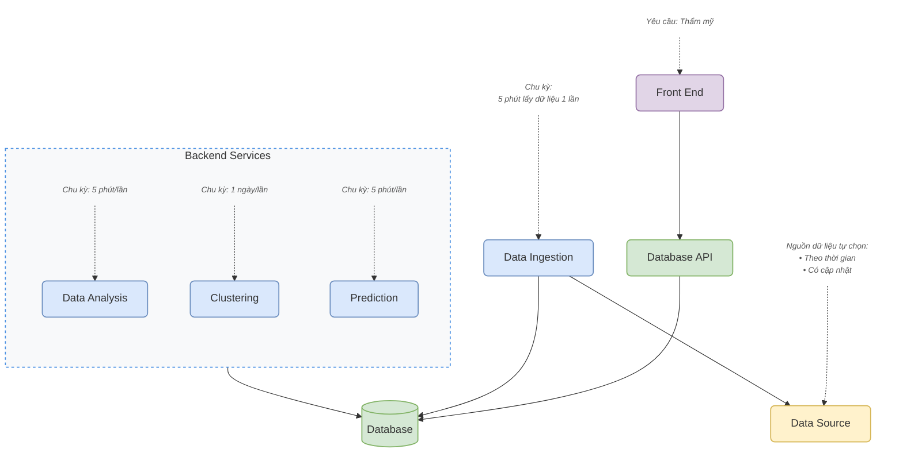

# 📋 YÊU CẦU BẮT BUỘC DỰ ÁN (TIME-SERIES)

> 💡 **Quy tắc triển khai quan trọng:**
> Mỗi khối trong kiến trúc hệ thống phải được chạy ở một terminal riêng biệt như một **service độc lập** (mô hình Microservices/Modular).

---

## 1. 🏗️ Sơ đồ Kiến trúc Hệ thống

### 1.1. Sơ đồ trực quan (Mermaid Diagram)



---

### 1.2. Sơ đồ dạng Text (ASCII)

```text
                                [ Thẩm mỹ ]
                                     │
                                     ▼
                              ┌──────────────┐
                              │  Front End   │
                              └──────┬───────┘
                                     │
                                     ▼
                              ┌──────────────┐
                              │ Database API │
                              └──────┬───────┘
                                     │
                                     ▼
┌──────────────┐     ┌──────────────┐     ┌──────────────┐     ┌────────────────────────────────────────────────┐
│ Data Source  │ ◄── │Data Ingestion│ ──► │   Database   │ ◄── │                Backend Services                │
└──────▲───────┘     └──────▲───────┘     └──────────────┘     │ ┌─────────────┐ ┌────────────┐ ┌─────────────┐ │
       │                    │                                  │ │Data Analysis│ │ Clustering │ │ Prediction  │ │
[Nguồn dữ liệu:      [Tần suất:                                │ └──────▲──────┘ └─────▲──────┘ └──────▲──────┘ │
 - Theo thời gian     5 phút lấy                               └────────┼──────────────┼───────────────┼────────┘
 - Có cập nhật]       dữ liệu 1 lần]                                    │              │               │
                                                                   [Tần suất:     [Tần suất:      [Tần suất:
                                                                    5 phút/lần]    1 ngày/lần]     5 phút/lần]
```

---

## 2. 📈 Các Patterns Phân Tích Bắt Buộc (Time-Series Data)

| STT | Nhóm Phân Tích | Chi Tiết Biểu Đồ & Yêu Cầu | Tần Suất / Phạm Vi |
| :---: | :--- | :--- | :---: |
| **1** | **Biểu diễn theo thời gian** | Vẽ **3 biểu đồ** tương ứng với các quãng thời gian:<br>• `Line chart` (Đường xu hướng)<br>• `Scatter plot` (Phân tán điểm)<br>• `Histogram` (Phân phối tần suất) | Ngày / Tuần / Tháng |
| **2** | **Trend Analysis** | Biểu diễn xu hướng (Trend) của dữ liệu sau khi thực hiện **Re-sampling** | Tháng *(hoặc Tuần nếu thiếu dữ liệu)* |
| **3** | **Seasonality** | Biểu diễn tính chu kỳ / mùa vụ (**Seasonal line**) sau khi **Re-sampling** | Tháng *(hoặc Tuần nếu thiếu dữ liệu)* |
| **4** | **Tương quan (Correlation)** | Ma trận tương quan (Correlation Matrix / Heatmap) giữa các biến đo đạc | Đa biến |
| **5** | **Hồi quy & Dự báo** | Hiển thị giá trị dự báo định lượng cho ngày tiếp theo *(Ví dụ: Nhiệt độ, phụ tải điện, giá cổ phiếu)* | Ngày kế tiếp ($t + 1$) |
| **6** | **Phân loại (Classification)** | Hiển thị nhãn phân loại dự đoán cho ngày tiếp theo *(Ví dụ: Thời tiết nắng/mưa, mức tiêu thụ cao/thấp)* | Ngày kế tiếp ($t + 1$) |

---

## 3. 🎯 Tiêu Chuẩn Sản Phẩm Mong Muốn (Deliverables)

### 🖥️ 3.1. Giao diện Người dùng (Frontend)
- [ ] **Độ bao phủ dữ liệu:** Hiển thị trực quan đầy đủ (hoặc mở rộng thêm) toàn bộ 6 patterns đã nêu ở mục 2.
- [ ] **Trải nghiệm & Thẩm mỹ:** Bố cục khoa học, hiện đại, phối màu trực quan, hỗ trợ tương tác lọc khoảng thời gian.

### ⚙️ 3.2. Kiến trúc & Vận hành Hệ thống
- [ ] **Chức năng:** Hệ thống chạy trơn tru, không gặp lỗi ngắt quãng chuỗi pipeline.
- [ ] **Kiến trúc module:** Tách bạch rõ rệt từng service (Ingestion, Database, API, Analysis, Prediction, UI).
- [ ] **Cập nhật tự động:** Luồng dữ liệu tự động ingest và cập nhật kết quả phân tích theo thời gian thực (định kỳ 5 phút / 1 ngày).

### 📑 3.3. Báo cáo & Tài liệu kỹ thuật
- [ ] Báo cáo trình bày sạch đẹp, bố cục chuẩn học thuật/kỹ thuật.
- [ ] Đầy đủ mô tả kiến trúc, công nghệ sử dụng, giải thuật áp dụng và phân tích kết quả.

### 🗣️ 3.4. Năng lực Phản biện & Hiểu sâu Hệ thống
- [ ] Nắm vững nguyên lý hoạt động của từng service và luồng dữ liệu truyền tải giữa các khối.
- [ ] Trả lời phản biện rõ ràng, tự tin các câu hỏi vấn đáp kỹ thuật từ hội đồng/giảng viên.